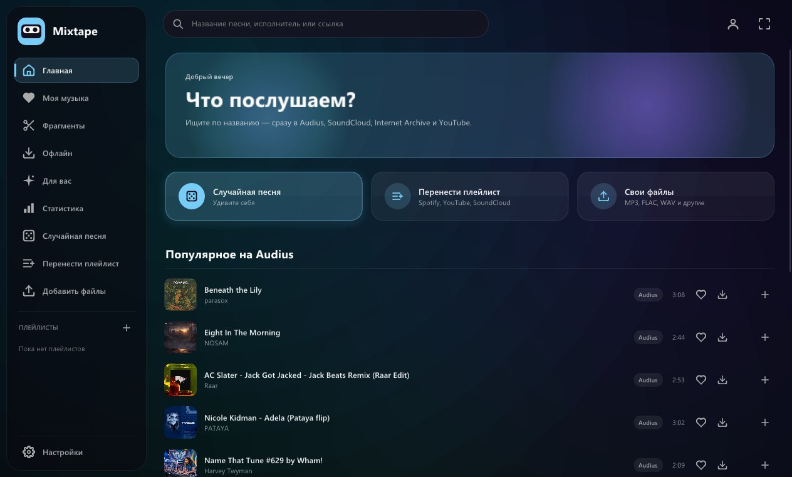
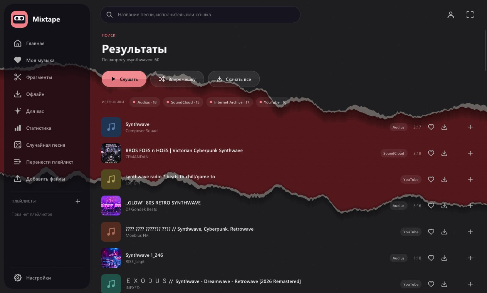
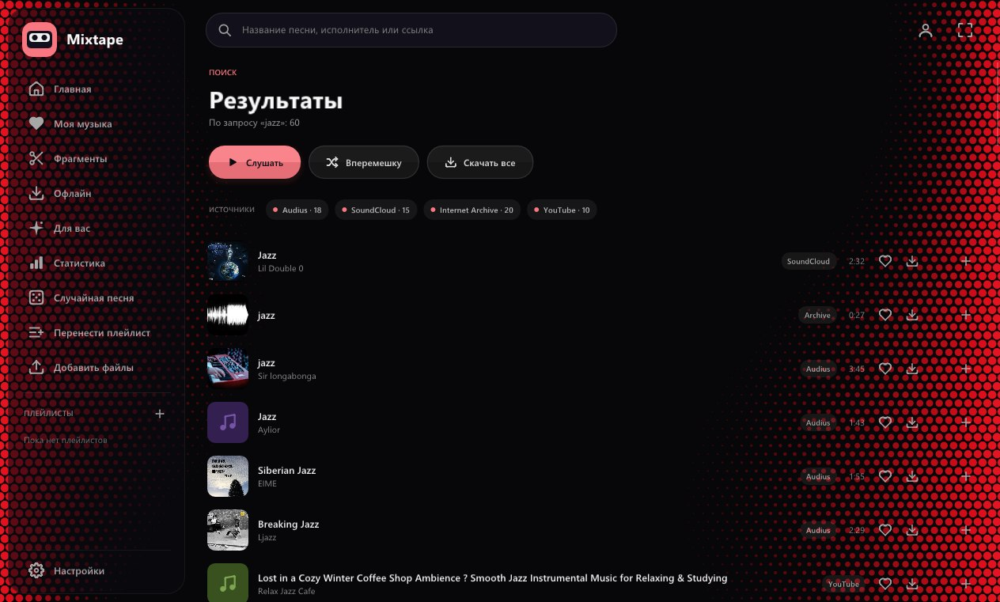
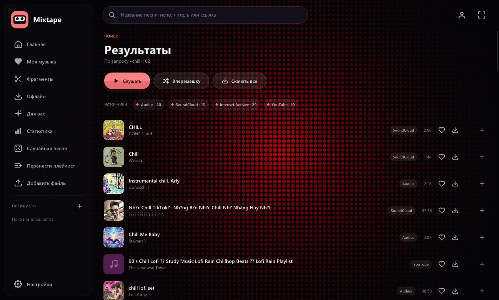
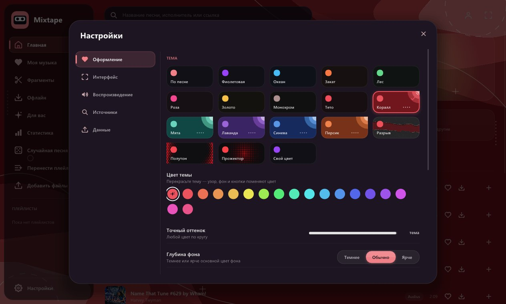

<div align="center">

# Mixtape

**Бесплатный музыкальный плеер для Windows и Android — без рекламы и с открытым кодом**

[](https://github.com/Lorine-ui/Mixtape/releases/latest/download/Mixtape.exe)
[](https://github.com/Lorine-ui/Mixtape/releases/latest/download/Mixtape.apk)

[](https://github.com/Lorine-ui/Mixtape/releases/latest)
[](https://github.com/Lorine-ui/Mixtape/releases)
[](LICENSE)
[](https://www.patreon.com/c/Mixtape696)



</div>

Один поиск сразу по Audius, SoundCloud, Internet Archive и YouTube, офлайн-режим, аккаунт с синхронизацией
между компьютером и телефоном, темы оформления и 10 языков интерфейса.

## Скриншоты

| | |
|---|---|
|  |  |
| Тема «Разрыв» | Тема «Полутон» |
|  |  |
| Тема «Прожектор» | Настройки: 17 тем и любой цвет |

## Скачать

| Платформа | Файл | Требования |
|---|---|---|
| Windows | [**Mixtape.exe**](download/Mixtape.exe?raw=1) | Windows 10/11, 64-бит. Установка не нужна — просто запустите файл |
| Android | [**Mixtape.apk**](download/Mixtape.apk?raw=1) | Android 10 или новее |

**Windows:** при первом запуске SmartScreen может предупредить о неизвестном издателе (у программы нет платной цифровой подписи) —
нажмите «Подробнее» → «Выполнить в любом случае».

**Android:** откройте APK на телефоне и разрешите установку из этого источника. При первом запуске разрешите уведомления —
так музыка играет с выключенным экраном, а в шторке есть кнопки управления.

## Возможности

- **Поиск везде сразу** — Audius, SoundCloud, Internet Archive и YouTube в одном списке.
- **Офлайн** — скачайте песню или сразу всю «Мою музыку» и слушайте без интернета. Можно добавлять свои MP3, FLAC, WAV.
- **Аккаунт** — вход по почте; «Моя музыка», плейлисты и профиль одинаковые на компьютере и телефоне.
- **Профиль** — аватарка, никнейм, «о себе», цвет и рамка.
- **Оформление** — 17 тем, включая узорные («Коралл», «Разрыв», «Полутон», «Прожектор»…); любую тему можно перекрасить,
  затемнить фон, поменять размер текста, скругление углов и плотность списков.
- **Тексты песен**, которые листаются в такт музыке, и свои тексты.
- **Фрагменты** — вырезать любимый кусок песни или убрать лишний.
- **Перенос плейлистов** из Spotify, YouTube и SoundCloud по ссылке, без ключей и входа.
- **Статистика** — сколько часов вы слушаете, любимые песни и исполнители; **подбор похожей музыки** по вашему вкусу.
- Таймер сна, медиаклавиши, работа в свёрнутом окне, полноэкранный режим, танцующая Тето (можно заменить своей картинкой или GIF).
- **10 языков**: русский, English, українська, español, Deutsch, français, português, italiano, polski, Türkçe.

## Ограничения

- Песни из интернета зависят от сторонних сайтов: если SoundCloud или YouTube что-то меняют у себя, часть песен может временно не играть.
- Синхронизируются списки песен, а не сами аудиофайлы: свои MP3 остаются на том устройстве, куда их добавили.
- Версий для iPhone и Mac пока нет.

## Исходный код

| Папка | Что внутри |
|---|---|
| [`pc/`](pc) | Версия для Windows (C++17, Dear ImGui, DirectX 11, miniaudio, WinHTTP, Media Foundation) |
| [`android/`](android) | Версия для Android (тот же C++ плюс OpenGL ES, NDK и небольшая обёртка на Java) |
| [`download/`](download) | Готовые сборки |

### Сборка для Windows

Нужны Visual Studio 2022 (или Build Tools) с компонентом «Разработка классических приложений на C++», CMake 3.21+ и Git.

```bat
cd pc
cmake -S . -B build -G "Visual Studio 17 2022" -A x64
cmake --build build --config Release
```

Или просто запустите `pc\build.bat`. При первой настройке CMake сам скачает Dear ImGui, miniaudio и stb.
Подробнее — в [pc/README.md](pc/README.md).

### Сборка для Android

Нужны JDK 17, Android SDK 34, NDK 26.3, CMake 3.22 и Gradle 8.7 в папке `%USERPROFILE%\Android`.
Запустите `android\android\build_apk.bat` — готовый `Mixtape.apk` появится в папке `android`.
Подробнее — в [android/ANDROID.md](android/ANDROID.md).

### Аккаунты

Аккаунты работают через Firebase (вход по почте и Realtime Database). Настройки проекта — в `app/cloud_config.hpp`.
Ключ проекта Firebase не секретный: доступ к данным ограничивают правила базы — каждый пользователь читает и пишет
только свою запись `users/<id>`. Чтобы подключить свой проект, укажите в этом файле свои `kFirebaseApiKey` и `kFirebaseDbUrl`.

### Тесты

```bat
cd pc
cmake -S . -B b -DMX_BUILD_APP=OFF
cmake --build b --config Release
ctest --test-dir b -C Release
```

## Лицензия

Код распространяется по лицензии [MIT](LICENSE): его можно свободно использовать, изменять и распространять с указанием автора.
Сторонние библиотеки, которые скачиваются при сборке (Dear ImGui, miniaudio, stb), — под своими лицензиями.

## Поддержать автора

Mixtape бесплатный и без рекламы. Если он вам нравится и хочется сказать спасибо — можно поддержать разработку на
[**Patreon**](https://www.patreon.com/c/Mixtape696). Это по желанию: приложение остаётся полностью бесплатным.
